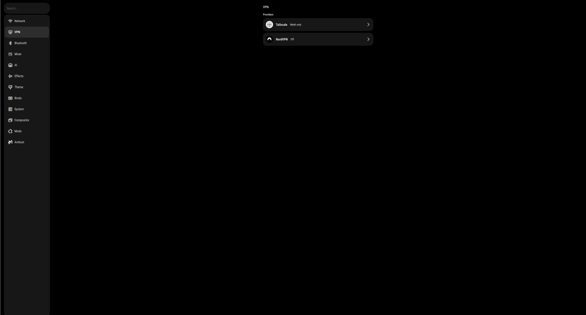
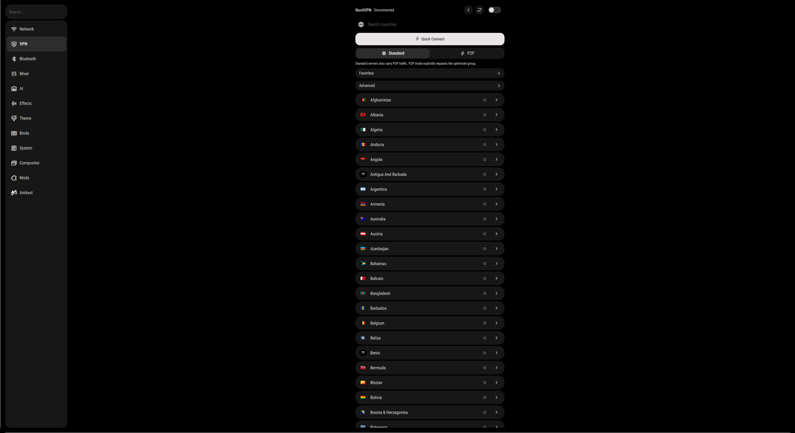
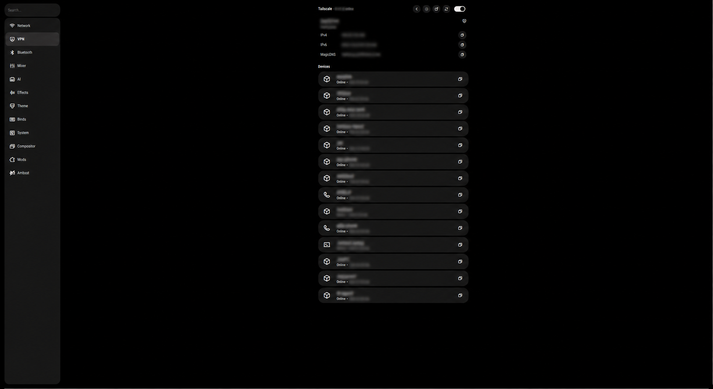

# VPN settings

Adds a VPN section to Ambxst Settings with Tailscale and NordVPN pages, a
provider handoff for moving the default route between them, and an optional
Tailscale item in the bar tray.



<p>

</p>

<p>

</p>

The Tailscale screenshot has network addresses, DNS details, device names and
other fleet information redacted.

## Install

```text
https://github.com/AspectHeat/ambxst-mods/tree/main/packages/vpn-settings
```

Paste that into **Settings → Mods**, or:

```bash
ambxst mods install https://github.com/AspectHeat/ambxst-mods/tree/main/packages/vpn-settings
ambxst mods enable aspect.vpn-settings
ambxst reload
```

Packages install disabled. Enabling builds a fresh source tree and takes effect
on the next `ambxst reload`. A failed build never touches the running shell.

## Requirements

No VPN CLI is required to enable the mod. Each provider page detects its own
CLI and shows "Not installed" when it is missing, so you only need the
providers you use. The NordVPN page has a setup button that installs and
configures the `nordvpn` CLI for you.

Works with Ambxst `>=1.3.0 <1.4.0`.

## Permissions

This mod runs the Tailscale and NordVPN CLIs with your user permissions. Read
the [manifest](ambxst.mod.json) before enabling it.

## License

MIT.
